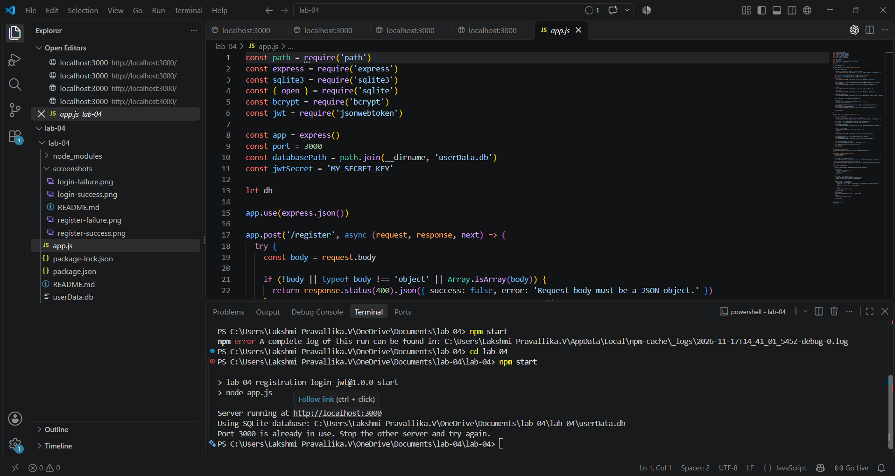
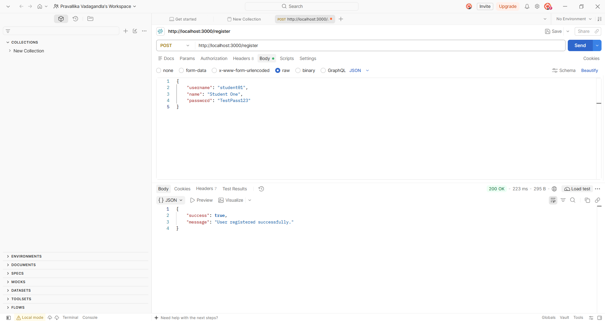
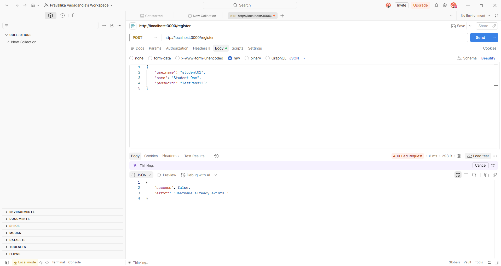
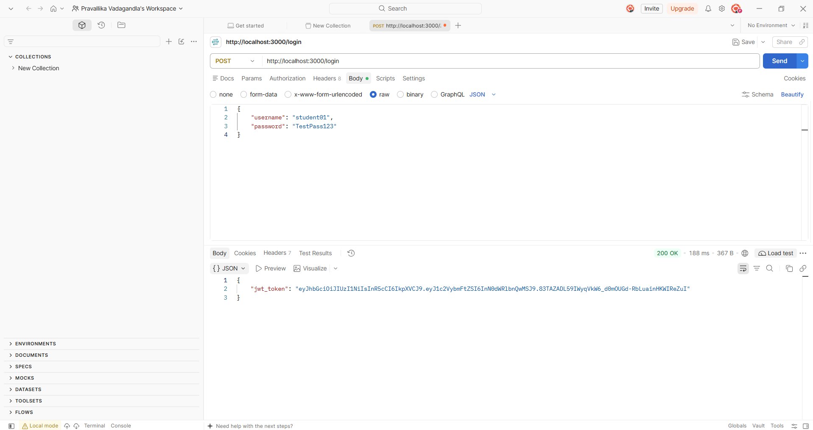
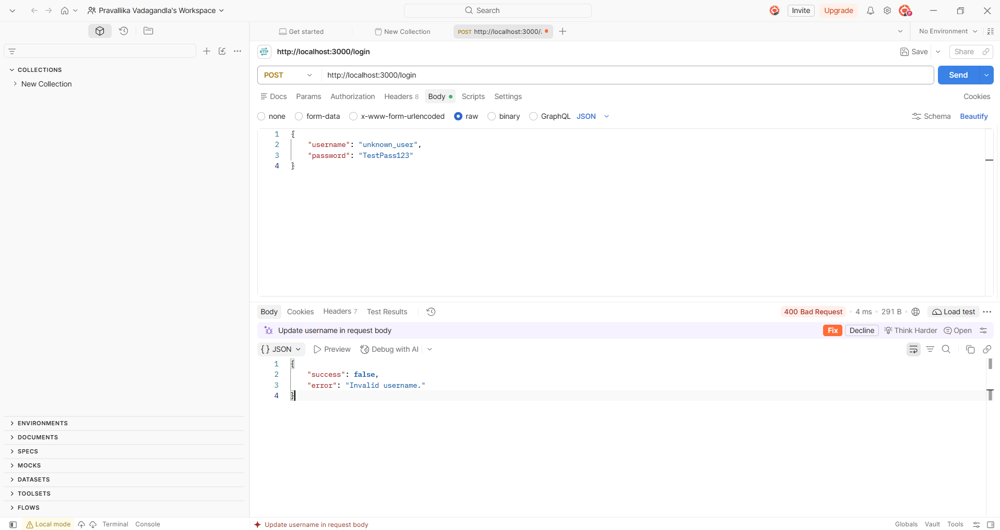
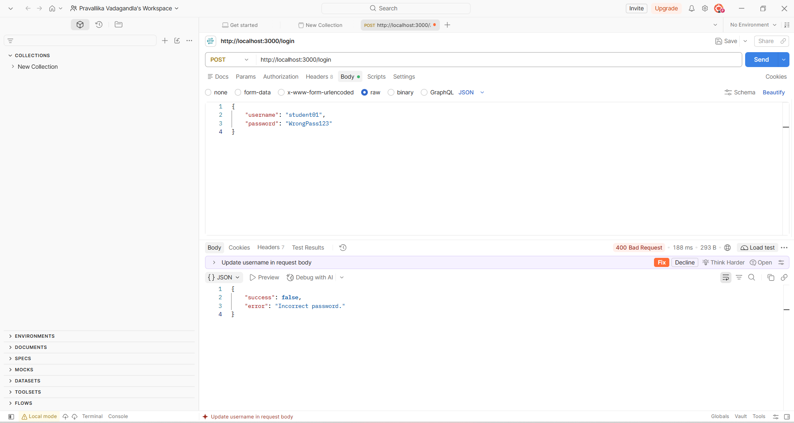
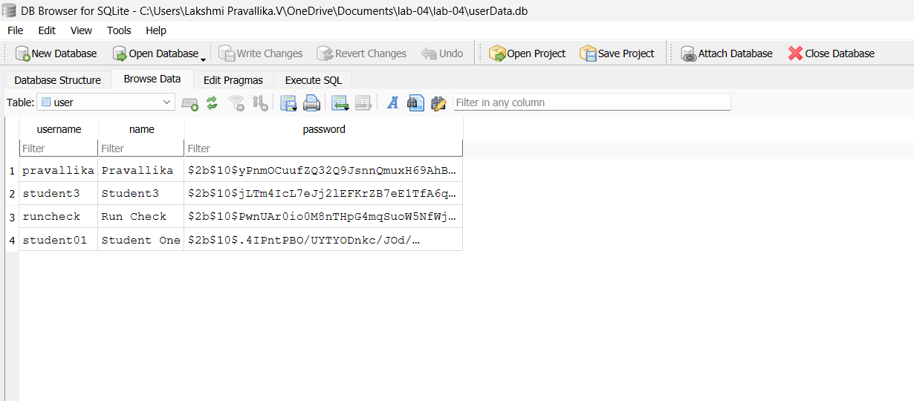
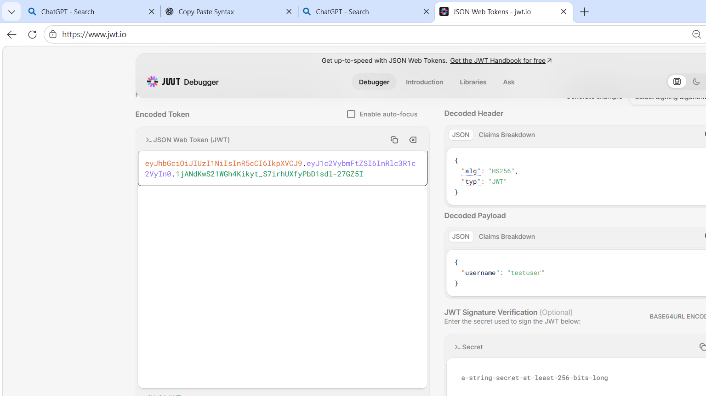

# Lab 4: Registration, Login and JWT

## Student Details

- **Name:** V. LAKSHMI PRAVALLIKA
- **Registration Number:** 252U1R1246
- **Section:** CSE 2E S-016
- **Course:** Backend Development Fundamentals
- **Year:** II
- **Term:** II
- **University:** Aurora
- **Faculty:** Yugandher

## Live Link

Not deployed. This local copy is prepared for local use; no hosting target was selected for this task.

## Objective

Build a simple registration and login API with Node.js and Express. User records are stored in SQLite, passwords are stored as bcrypt hashes, and a successful login returns a JWT containing only the username.

## Technologies Used

- Node.js and JavaScript (CommonJS)
- Express.js
- SQLite with the sqlite and sqlite3 packages
- bcrypt for password hashing and verification
- jsonwebtoken for JWT generation
- Postman for manual API testing

## Project Structure

BACKEND/

- lab-01/
- lab-02/
- lab-03/
- lab-04/
  - app.js
  - userData.db (created automatically when the server starts)
  - package.json
  - package-lock.json
  - README.md
  - screenshots/

## Installation Instructions

Use Node.js 20.17 or newer, then open a terminal in the lab-04 folder and install the packages:

    npm install

The required packages are express, sqlite, sqlite3, bcrypt, and jsonwebtoken. To install them directly, use:

    npm install express sqlite sqlite3 bcrypt jsonwebtoken

## How to Run the Application

From the lab-04 folder, start the server with:

    npm start

You can also run `node app.js` directly.

The API listens at http://localhost:3000. The server opens userData.db and creates the user table before it starts accepting requests. Stop the server with Ctrl+C.

## Database Structure

Database file: userData.db

Table: user

| Column | Type | Rule |
| --- | --- | --- |
| username | TEXT | UNIQUE |
| name | TEXT | User's name |
| password | TEXT | bcrypt hash only |

All user-provided values in SQL statements are passed through parameterized queries. The original password is never inserted into the database.

## API Documentation

The API accepts and returns JSON. For requests with a body, choose Body > raw > JSON in Postman or set Content-Type to application/json.

## Registration API

- **HTTP method:** POST
- **API path:** /register
- **Purpose:** Create a new user account.
- **Request body:**

        {
          "username": "pravalika",
          "name": "Pravalika",
          "password": "pravalika123"
        }

- **Successful response (HTTP 200):**

        {
          "success": true,
          "message": "User registered successfully."
        }

- **Error responses (HTTP 400):** A username already exists, a required field is missing, or the password has fewer than 5 characters.

## Login API

- **HTTP method:** POST
- **API path:** /login
- **Purpose:** Check a user's password and return a JWT after successful verification.
- **Request body:**

        {
          "username": "pravalika",
          "password": "pravalika123"
        }

- **Successful response (HTTP 200):**

        {
          "jwt_token": "generated_jwt_token"
        }

- **Error responses (HTTP 400):** The username is not registered or the password is incorrect.

## JWT Authentication Explanation

The application creates the token with jsonwebtoken's jwt.sign() after bcrypt confirms the password. The payload is exactly one field: username. The token signing options omit the timestamp so the decoded payload contains no extra field. The secret key is a placeholder constant in app.js: MY_SECRET_KEY. Replace it with a protected secret before using this pattern outside a classroom exercise; do not put the secret in the payload.

A JWT has three parts separated by periods:

1. **Header:** identifies the token type and signing algorithm (jsonwebtoken uses HS256 by default).
2. **Payload:** contains the username only in this assignment.
3. **Signature:** proves the token was signed with the secret key and helps detect changes.

The header and payload can be decoded by a JWT viewer such as jwt.io. Decoding does not hide them; the signature is used to verify token integrity.

## Password Hashing Explanation

During registration, bcrypt.hash(password, 10) uses a work factor of 10 and stores the resulting hash in the password column. During login, bcrypt.compare() checks the entered password against that hash. The application does not store or return the plain-text password.

## Postman Testing

Start the server, then create POST requests to http://localhost:3000. For each request, select Body > raw > JSON.

1. **Successful registration:** POST /register with username Pravalika, name Pravalika, and password pravalika123. Expected status: 200.
2. **Duplicate registration:** send the same registration request again. Expected status: 400.
3. **Short password:** POST /register with a new username, any non-empty name, and a password shorter than 5 characters. Expected status: 400.
4. **Successful login:** POST /login with username pravalika and password pravalika123. Expected status: 200 with jwt_token.
5. **Incorrect password:** POST /login with username pravalika and a different password. Expected status: 400.
6. **Unknown username:** POST /login with a username that has not been registered. Expected status: 400.

Use a fresh database for the successful registration test if the username is already present. To reset local test data, stop the server and remove userData.db; the application will create a new database and user table on the next start.

The screenshots below are the original figures extracted from the submitted lab report and are shown in their document order.

## Expected Output

- A new unique username is registered with HTTP 200.
- A duplicate username and a password shorter than 5 characters are rejected with HTTP 400.
- Correct login credentials return HTTP 200 and a jwt_token value.
- An incorrect password or unknown username is rejected with HTTP 400.
- The SQLite password column contains a bcrypt hash, not the original password.

## Conclusion

This lab demonstrates registration, login, SQLite persistence, bcrypt password hashing, input checks, and JWT generation using a small CommonJS Express application.

## Screenshots

### 1. Server Running

### 2. Register API – Successful Registration

### 3. Register API – Duplicate Username

### 4. Login API – Successful Login

### 5. Login API – Unknown Username

### 6. Login API – Incorrect Password

### 7. Users Table – Hashed Password

### 8. JWT Decoded – Header and Payload

